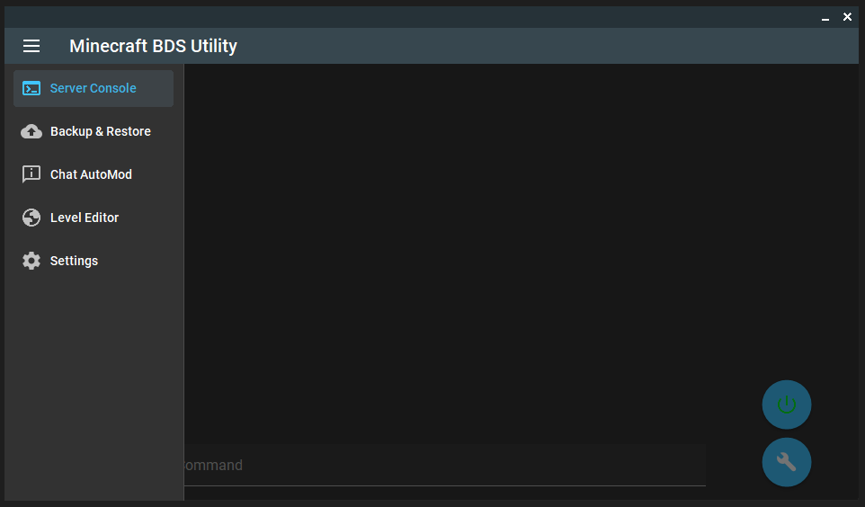
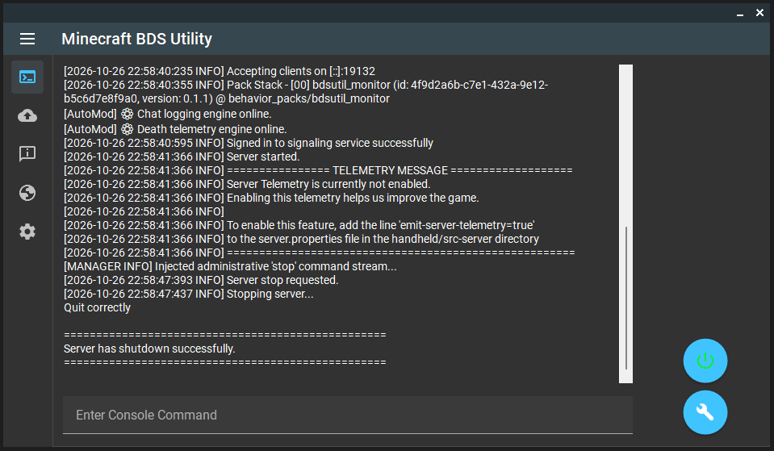
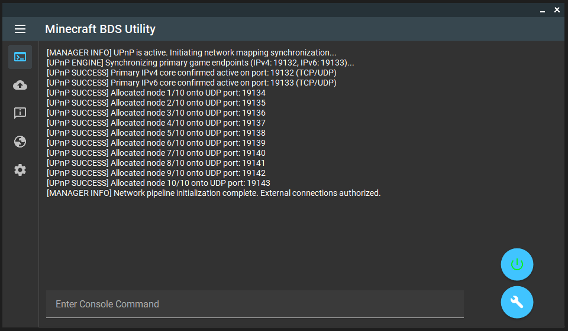
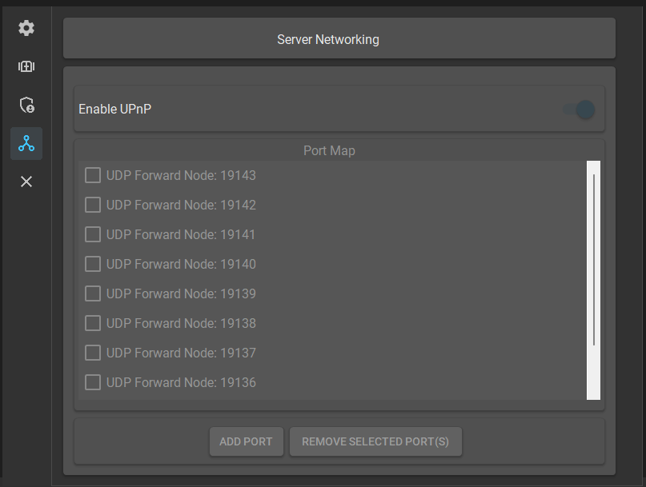
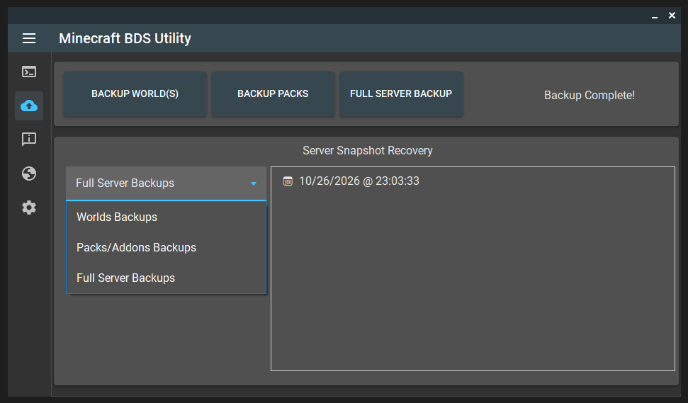

# BDSUtil 

## Note on recent Nethernet Changes:
As of BDS v26.61 NetherNet is seemingly fixed. I am currently testing a Reverse Proxy that will serve the connection over TLS. If by chance Mojang breaks NetherNet in another update similar to 26.60, this feature would allow your server to continue to function...with a caveat: you must have a domain and valid TLS certificate.
When this feature is implemented, it will be entirely optional. Further along the road it is planned to add the ability to bypass the domain requirement by using a service like NIP/SSLIP to map your external ip to a "domain" and then with a little cooperation from you, the user, automatically generate a cert via ACME.

BDSUtil is a C# desktop wrapper I'm putting together to make managing Minecraft Bedrock Dedicated Servers (BDS) a lot less of a headache. It wraps the server console in a clean UI, handles backups and updates, automatically forwards and verifies ports via native UPnP, includes a native AutoMod bridge, and ships an optional Remote Management API.

**Disclaimer:** BDSUtil is a personal project and is not affiliated with, endorsed by, or associated with Mojang Studios or Microsoft Corporation. Minecraft, Bedrock Edition, and BDS are trademarks or registered trademarks of their respective owners.

THE SOFTWARE IS PROVIDED "AS IS", WITHOUT WARRANTY OF ANY KIND, EXPRESS OR IMPLIED. 

WITHOUT LIMITING THE FOREGOING, I ACCEPT ABSOLUTELY NO LIABILITY IF THIS SOFTWARE CORRUPTS YOUR DATA, CAUSES YOUR ALARM NOT TO GO OFF RESULTING IN YOU MISSING WORK, DESTROYS YOUR HARDWARE, OR INADVERTENTLY TRIGGERS A THERMONUCLEAR WAR. YOU USE THIS SOFTWARE ENTIRELY AT YOUR OWN RISK.

---

## 🚀 Getting Started

1. **Link Your Server:** Just launch BDSUtil. If you drop it in the same folder as your server, it will automatically find `bedrock_server.exe`. Otherwise, pop into the Settings tab and point it to your server's root folder.
2. **Fire it Up:** Head to the Server Console tab and hit the green power button. You'll get a clean terminal feed without the usual Bedrock telemetry spam.
3. **UPnP (Optional):** Tired of manual port forwarding? Turn on UPnP in the settings. On server startup (or when changing server directories), it automatically leases the required IPv4 TCP/UDP ports, configures `server.properties`, and verifies reachability.
4. **AutoMod (Optional):** Head to the Chat AutoMod tab to enable the custom `bdsutil_monitor` behavior pack. *Note: Enabling this automatically patches your world's `level.dat` for Beta APIs, which permanently turns off Xbox achievements for that specific world.*
5. **Remote Management API (Optional):** Off by default. Enable it in Settings (after reviewing the security prompt) to generate an API key and expose local/remote HTTP control endpoints for companion clients.

---

## ✨ Features

### 🖥️ Interactive Console

- **Clean Feed:** Streams the server log directly into the app, actively filtering out noisy engine telemetry (including an optional setting to suppress `"Telemetry not enabled"` startup notices).
- **Live Commands:** Send commands straight to the server via the built-in terminal.
- **Quick Toggles & `server.properties` Hygiene:** Start and stop the server instantly with floating action buttons, while automatically commenting out obsolete `server-portv6` entries ignored under NetherNet.

### 🛡️ AutoMod & Telemetry Bridge
- **Behavior Pack Injection:** Automatically installs and registers the custom `bdsutil_monitor` Script API behavior pack into your active world to stream live game events.
- **Live Parsing:** Translates raw JSON telemetry into clean, emoji-tagged terminal alerts for Chat, PvP Kills, and Environmental Deaths.
- **Chat Filter & Strike Escalation:** Custom banned-word filter (`Chat Filter`) paired with configurable Primary & Secondary enforcement actions (e.g., `Kick`, `Temp-Ban(24h)`), strike thresholds, and timed strike-reset windows.
- **Anti-Spam Engine:** Detects message-rate floods over a configurable time window and applies automated sanctions (e.g., `Mute(5m)`) with its own strike reset window.
- **Enforcement Profiles & Player Identity Store:** Inspect individual player XUID/gamertag sanction logs, view the triggering message, clear active sanctions or reset records ("Clean Slate"), and maintain XUID-to-gamertag lookups in `bds_players.json` (with automatic migration from legacy `bds_players.dat`).

### 🌐 UPnP & Network Management

- **Secure by Default:** UPnP is strictly disabled out of the box—you must explicitly enable it.
- **Native .NET 11 UPnP Engine:** Uses a built-in SSDP/SOAP Internet Gateway Device client (no external UPnP library dependencies) to lease IPv4 `server-port` TCP/UDP, sequential `server-udp-ports` pools, and the Remote Management API port when enabled, syncing across server directory changes and scrubbing router leases cleanly on exit.
- **`[BETA]` Consolidate UDP Ports:** Optional toggle to ignore the max-players pool and consolidate UDP mapping onto the primary server port.
- **Reachability Verification & Optional External Checker:** During startup batch setup (`[UPnP] Verifying...`), checks TCP reachability via loopback and an optional **External Port Checker API** (`Off` by default for privacy, or choose `ifconfig.co`, `ipconfig.io`, `portchecker.io`, or a custom `{port}` / `{ip}` / `{protocol}` endpoint), confirms UDP leases in the router's active UPnP table (retrying missing leases automatically), and reports concise success or actionable Double-NAT/CGNAT failure diagnostics.
- **Manual Networking Control:** Built-in `server-udp-ports` manager with an interactive **Verify Ports** button (guarded behind network safety acknowledgments when UPnP is off).

### 📡 Remote Management API *(Off by Default)*
- **Zero-Elevation HTTP/JSON Server:** Lightweight built-in `TcpListener` API server that runs without administrator privileges or `http.sys` URL ACL registration.
- **Security Controls:** Strictly disabled by default behind an explicit risk acknowledgment modal, authenticated via cryptographically generated Bearer / `X-API-Key` tokens (with one-click copy and key rotation in Settings), and protected by per-IP failed-auth rate limiting.
- **Automatic Port & UPnP Integration:** Selects an available port (or uses an optional preferred port) and coordinates its UPnP mapping automatically when UPnP is active.
- **REST Endpoints (`/api/v1/...`):** Health check (`/ping`), host & server telemetry (`/status`), console buffer retrieval (`/console`), server start/stop/restart/commands (`/server/start`, `/stop`, `/restart`, `/command`), live player list & moderation actions (`/players`, `/players/action`), allowlist & operator inspection/updates (`/whitelist`, `/operators`), `server.properties` read/write (`/server/properties`), backup listing & triggers (`/backups`), AutoMod/app configuration (`/config`, `/automod`), and UPnP status/verification (`/network/upnp`, `/network/upnp/verify`). *(Formal API docs and companion mobile apps are still in progress; see source for request/response schemas.)*

### 💾 Backups & Recovery

- **Granular Backups:** Back up your whole server, or isolate specific Worlds and Packs (`Full Server Backup`, `Backup Packs`, `Backup World(s)`).
- **Compression:** Uses standard Windows `.zip` compression, or automatically hooks into WinRAR if installed.
- **One-Click Restore:** A dedicated snapshot recovery hub (`Restore Selected Snapshot`) to wipe and roll back worlds to saved archive states.

### 📝 Configuration & Level Editor
- **Real-Time Server Config GUI:** View, toggle, and update `server.properties`, `allowlist.json` whitelist profiles, `permissions.json` operators, and networking rules right from a clean Material UI.
- **`level.dat` Experiment Editor:** Optional safety-gated world editor in Settings to inspect and toggle Bedrock experiments (`Upcoming Creator Features`, `Beta APIs`, `Deferred Technical Preview`) directly inside `level.dat`.
- **Unified App Configuration:** Consolidates settings into `config.json` with automatic migration from legacy config files.

### 📦 Addon & Pack Management
- **Automated Directory Discovery:** Automatically detects and indexes your server's `behavior_packs` and `resource_packs` directories without manual navigation.
- **One-Click Import:** Drag and drop (or browse for) `.mcpack` and `.mcaddon` files directly into the UI to unpack and register them to your active world profile.
- **Conflict Resolution:** Safely parses manifest dependencies and alerts you to version conflicts or missing Script API requirements before packs break world load.

### 🔄 BDS Core Updates
- **Automated Update Pipeline:** Checks official Bedrock Dedicated Server endpoints on launch and fetches the latest server binaries automatically.
- **Safe File Swapping:** Intelligently migrates and preserves your configurations, active worlds, and custom packs during the upgrade process so no data is lost.

---

## 📚 Libraries & Credits
This project leverages the following components:
- **[material3-dotnet](https://github.com/dary1337/material3-dotnet):** Created by [dary1337](https://github.com/dary1337), providing the Material Design 3 (Material You) WinForms component library that powers BDSUtil's UI layout.
- **Native .NET 11 Networking:** Built-in SSDP/SOAP UPnP IGD engine and self-hosted `TcpListener` HTTP/JSON API server (replacing the earlier `Open.NAT` dependency).

---

## 🗺️ Roadmap

- 📱 **Companion Apps & API Docs:** Dedicated Android and Web companion clients (plus full endpoint documentation) built on top of the Remote Management API introduced in `v1.1.0`.
- 🔒 **Optional TLS Reverse Proxy & ACME Automation:** Configurable TLS tunneling and automated certificate provisioning if future Bedrock/NetherNet changes require encrypted transport.