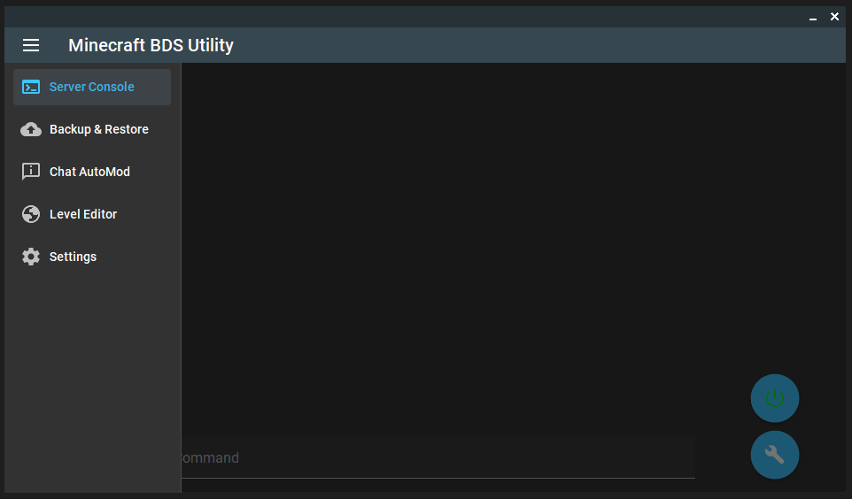
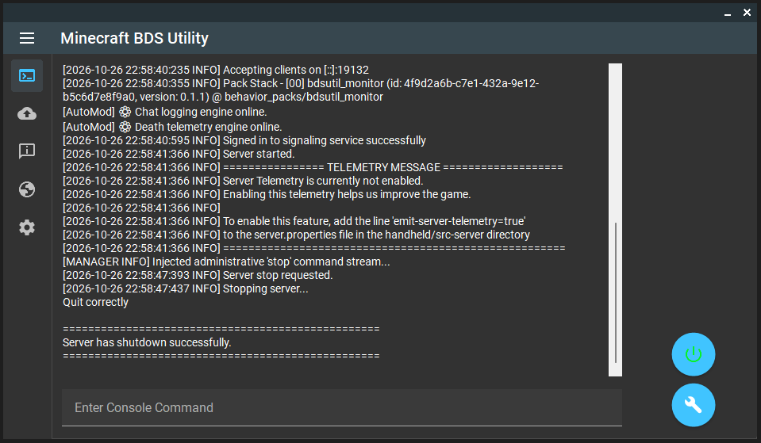
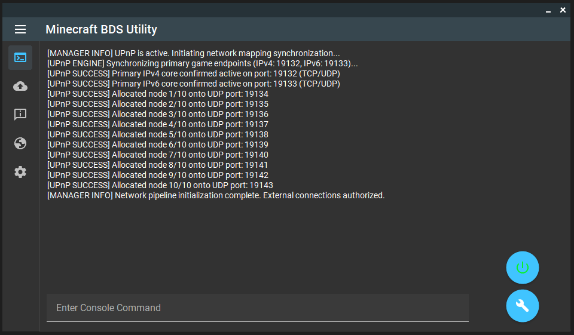
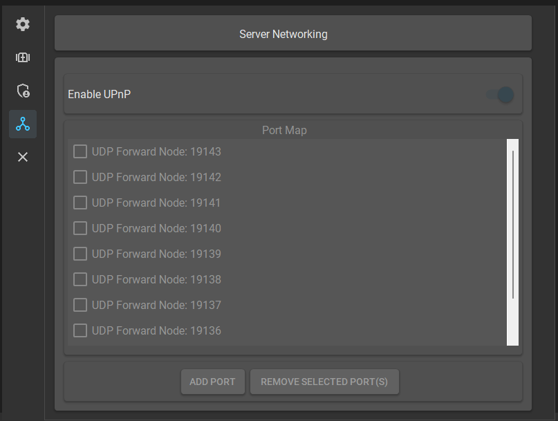
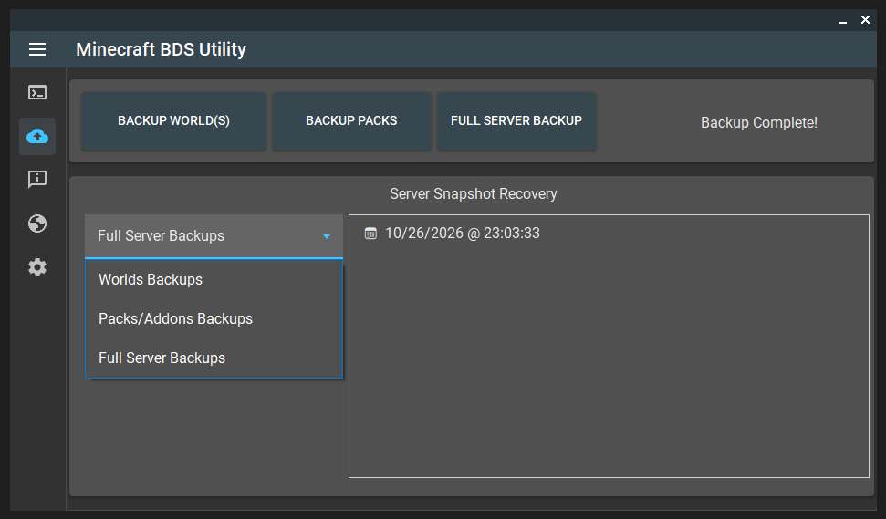

# BDSUtil ⚠️ NOTE: Nethernet seems to have been further broken as of 26.60(10/27/2026)

⚠️ NOTE: Nethernet seems to have been further broken as of 26.60(10/27/2026)
I will continue development and look out for community fixes along the way.
Unfortunately, I may be forced to implement a 3rd party proxy that, unlike <redacted>, has a working NetherNet Implementation.

BDSUtil is a C# desktop wrapper I'm putting together to make managing Minecraft Bedrock Dedicated Servers (BDS) a lot less of a headache. It wraps the server console in a clean UI, handles backups, automatically forwards ports via UPnP, and I'm currently experimenting with a native AutoMod bridge.

**Disclaimer:** BDSUtil is a personal project and is not affiliated with, endorsed by, or associated with Mojang Studios or Microsoft Corporation. Minecraft, Bedrock Edition, and BDS are trademarks or registered trademarks of their respective owners.

THE SOFTWARE IS PROVIDED "AS IS", WITHOUT WARRANTY OF ANY KIND, EXPRESS OR IMPLIED. 

WITHOUT LIMITING THE FOREGOING, I ACCEPT ABSOLUTELY NO LIABILITY IF THIS SOFTWARE CORRUPTS YOUR DATA, CAUSES YOUR ALARM NOT TO GO OFF RESULTING IN YOU MISSING WORK, DESTROYS YOUR HARDWARE, OR INADVERTENTLY TRIGGERS A THERMONUCLEAR WAR. YOU USE THIS SOFTWARE ENTIRELY AT YOUR OWN RISK.

---

## 🚀 Getting Started

1. **Link Your Server:** Just launch BDSUtil. If you drop it in the same folder as your server, it will automatically find `bedrock_server.exe`. Otherwise, pop into the Settings tab and point it to your server's root folder.
2. **Fire it Up:** Head to the Server Console tab and hit the green power button. You'll get a clean terminal feed without the usual Bedrock telemetry spam.
3. **UPnP (Optional):** Tired of manual port forwarding? Turn on UPnP in the settings. On the next server boot, it will automatically lease the required TCP/UDP routes for you and your players.
4. **AutoMod (WIP):** Head to the Chat AutoMod tab to enable the custom `bdsutil_monitor` behavior pack. *Note: Enabling this automatically patches your world's level.dat for Beta APIs, which permanently turns off Xbox achievements for that specific world.*

---

## ✨ Features

### 🖥️ Interactive Console

- **Clean Feed:** Streams the server log directly into the app, actively filtering out the noisy engine telemetry spam.
- **Live Commands:** Send commands straight to the server via the built-in terminal.
- **Quick Toggles:** Start and stop the server instantly with floating action buttons.

### 🛡️ AutoMod & Telemetry Bridge (⚠️ Partially Implemented / WIP)
*Note: This feature is currently in active development. The backend telemetry intercepts are working, but the rule configuration UI is still being built.*
- **Behavior Pack Injection:** Automatically installs a custom `bdsutil_monitor` Script API behavior pack into your world to extract live game events.
- **Live Parsing:** Translates raw JSON telemetry into clean, emoji-tagged terminal alerts for Chat, PVP Kills, and Environmental Deaths.
- **Automated Enforcement (Coming Soon):** Will soon evaluate live chat against configurable filters to instantly auto-kick or mute griefers.

### 🌐 UPnP & Network Management

- **Secure by Default:** UPnP is strictly disabled out of the box. You have to explicitly turn it on.
- **Auto-Routing:** Negotiates router firewall tables on app launch so you don't have to manually port-forward.
- **Dynamic Pools:** Proactively leases sequential UDP ports (starting at `19134`) to smoothly balance multiple player connections up to your max-players limit.
- **Self-Cleaning:** Cleans up after itself by scrubbing the temporary hardware rules from your router when the app closes, returning `server.properties` to a pristine state.
- **Known Limitation:** The UPnP implementation cannot verify if a requested port is already manually forwarded. Due to a common router limitation, UPnP may report a successful lease even if a manual forward already exists (the manual forward will take priority). Using a third-party port checking API could resolve this, but was explicitly ruled out to maintain strict security and privacy standards.

### 💾 Backups & Recovery

- **Granular Backups:** Back up your whole server, or just isolate specific Worlds and Packs.
- **Compression:** Uses standard Windows `.zip` compression, or automatically hooks into WinRAR if you have it installed.
- **One-Click Restore:** A dedicated restoration hub to quickly wipe and roll back worlds to older archive states when things go wrong.

### 📝 Configuration Editor
- **GUI Management:** View, toggle, and update your `server.properties` and whitelist profiles right from a clean UI dashboard—no more digging through text files.

---

## 📚 Libraries & Credits
This project leverages a couple of incredible open-source libraries:
- **[ReaLTaiizor](https://github.com/Taiizor/ReaLTaiizor):** A massive .NET WinForms component library that powers BDSUtil's modern Material Design layout.
- **[Open.NAT](https://github.com/lontivero/Open.NAT):** A lightweight library used to seamlessly manage the UPnP port mapping allocations.

---

## 🗺️ Roadmap
- 📦 **Addon & Pack Management:** A dedicated in-app installer and manager for external custom server additions.
- 🔄 **BDS Core Updates:** An automated updating pipeline to fetch and install the latest Bedrock Dedicated Server binaries.
- 📱 **Remote Management API & Companion Apps:** An optional, lightweight remote management API allowing you to monitor and control your server on the go via upcoming Android and Web companion apps.
